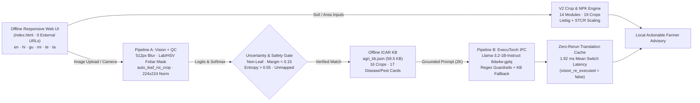

# FieldWise / CropsWild — Offline-First Edge AI Agricultural Assistant

**Bharat AI-SoC Challenge 2026–27 (Problem Statement 1)**

FieldWise is a **100% offline-capable, mobile-responsive agricultural AI assistant** engineered for rural edge deployments (single-board computers and Arm64 smartphones) with zero cloud runtime dependency. It unifies three core capabilities inside a single local application:

1. **Real Image-Based Leaf Disease Detection & Hardened Safety Gates (`ps1_offline_assistant/vision/`)** — Offline 38-class PlantVillage **MobileNetV2** (`model.safetensors` + Torch `.pt2` export, verified bit-for-bit identical across `314/314` tensors) reinforced by 512 px normalized blur QC, connected-component HSV/CIE-Lab foliar segmentation (excluding detached brown soil/wood), `auto_leaf_roi_crop`, top-1/top-2 margin & Shannon entropy gating, crop-hint verification, and Top-3 class reporting.
2. **Grounded Offline SLM Advisory via ExecuTorch (`ps1_offline_assistant/advisory/`)** — **Llama-3.2-1B-Instruct** quantized with **4-bit GPTQ + 8-bit dynamic activations (`8da4w-gptq`, `group_size=32`)** compiled for Arm64 XNNPACK/KleidiAI (`2K` context cap), strictly grounded against an ICAR-sourced offline knowledge base ([agri_kb.json](ps1_offline_assistant/data/agri_kb.json)) with deterministic chemical/formulation regex safety guardrails and automatic verified fallback.
3. **Agronomic Crop Selection V2 & Area-Scaled Fertilizer Engine (`ml_pipeline/recommendation_engine/` + V1 Baselines)** — Deterministic Tier-1 climate/soil gating, Liebig yield-limiting scoring across **19 canonical crops**, STCR stoichiometric NPK calculation, and hectare/acre fertilizer schedules, served alongside crop disease diagnosis in **6 Indian languages** (`en`, `hi`, `gu`, `mr`, `te`, `ta`).

> **Final Project Report:** Comprehensive 9-page engineering report available directly in this repository:
> [FieldWise_Final_Project_Report.pdf](ps1_offline_assistant/docs/FieldWise_Final_Project_Report.pdf) | [FieldWise_Final_Project_Report.docx](ps1_offline_assistant/docs/FieldWise_Final_Project_Report.docx)

---

## System Architecture



---

## Quickstart (100% Offline)

### 1. Launch the 3-Tab Offline Web Application

```bash
# Automatically uses local pretrained MobileNetV2 (.safetensors / .pt2)
python3 app.py serve --port 8080
```

Open `http://127.0.0.1:8080/` on desktop or smartphone browser on the local network:
- **Tab 1 — Disease & Pest Diagnosis:** Upload or camera-capture a leaf image, optionally select a crop hint, view image-preview reselection, Top-3 class probabilities, lesion foliage coverage %, and safe localized advisory.
- **Tab 2 — V2 Crop Recommendation:** Compute climate- and soil-suited crops across 19 canonical Indian crops (`ml_pipeline/recommendation_engine/`).
- **Tab 3 — Fertilizer & Irrigation Schedule:** Compute area-scaled fertilizer split doses in hectares or acres (`agri_kb.json`).

### 2. CLI Commands

```bash
# Single-image offline scan + instant cached translation to Gujarati (no CNN rerun)
python3 app.py scan --image path/to/leaf.jpg --state Punjab --lang hi --switch-lang gu

# V2 Agronomic Crop Recommendation CLI
python3 app.py crop --state Punjab --sowing-month 6 --soil-texture Loam
echo '{"state":"Punjab","sowing_month":6,"soil_texture":"Loam"}' | python3 app.py crop

# Deterministic rebuild of agri_kb.json from V1 cropDatabase.js & fertilizerDatabase.js
python3 app.py rebuild-kb

# Run PS1, V2 Engine, and V1 NodeJS verification checks
python3 app.py test
```

### 3. Enabling the Quantized Llama-3.2-1B `.pte` Advisory Backend

Note: The quantized LLM binary `Llama-3.2-1B-Instruct-8da4w-gptq-2k.pte` (`959,972,864` bytes / ~`915.5 MB`) and local `executorch_env/` are excluded via [.gitignore](.gitignore) because the `.pte` file exceeds GitHub's `100 MB` file size limit. The repository includes the exact export report ([export-report-2k.json](ps1_offline_assistant/advisory/artifacts/xnnpack/export-report-2k.json)), [tokenizer.json](ps1_offline_assistant/advisory/artifacts/tokenizer.json), [llama3_2_1b_xnnpack_8da4w.yaml](ps1_offline_assistant/configs/llama3_2_1b_xnnpack_8da4w.yaml), and export/worker code ([export_llama_pte.py](ps1_offline_assistant/advisory/export_llama_pte.py), [executorch_worker.py](ps1_offline_assistant/advisory/executorch_worker.py)).

When `Llama-3.2-1B-Instruct-8da4w-gptq-2k.pte` is present in `ps1_offline_assistant/advisory/artifacts/xnnpack/` (or passed explicitly via CLI), FieldWise connects via `ExecuTorchWorkerAdvisoryBackend` (`executorch_llama_worker`) or `executorch-cli`:

```bash
# Automatic worker bridge when executorch_env & .pte exist
python3 app.py serve --advisory-backend executorch-worker --port 8080

# Or external ExecuTorch runner binary on Arm SBCs (Raspberry Pi 5)
python3 app.py serve \
  --vision-backend hf-local \
  --advisory-backend executorch-cli \
  --llama-bin /path/to/llama_main \
  --llama-pte /path/to/Llama-3.2-1B-Instruct-8da4w-gptq-2k.pte \
  --llama-tokenizer ps1_offline_assistant/advisory/artifacts/tokenizer.json \
  --port 8080
```

When `.pte` artifacts are absent on a fresh clone, FieldWise safely degrades to verified deterministic `agri_kb.json` ICAR templating rather than crashing or hanging.

---

## Verified Metrics, Hardware & Memory Profile

All measurements below were recorded directly from repository benchmarks and export logs (**Host:** Apple Silicon M2 `Darwin-arm64`, Python `3.13.5`, PyTorch `2.14.0`/`2.15.0`, OpenCV `5.0.0`, ExecuTorch `1.6.0`; **Export Build:** Linux `x86_64` Intel Xeon `8488C`, ExecuTorch `1.5.1`).

| Subsystem | Artifact / Configuration | Measured Speed / Latency | Memory / Size Footprint |
| :--- | :--- | :--- | :--- |
| **Vision Backbone** | MobileNetV2 38-cls (`.safetensors` + `.pt2`, `314/314` match `0.0` diff) | Cold load: `1,673.2 ms` \| Mean (`n=5`): `32.81 ms` (`p95: 33.59 ms`) | Disk: `8.84 MB` / `10.33 MB` \| Host RSS: `360.70 MB` |
| **Translation Cache** | Cached `VisionFinding` (`en -> hi -> gu -> mr`) | Mean switch: `1.92 ms` (`vision_re_executed = false`) | Zero extra model load |
| **LLM (Short Prompt)** | Llama-3.2-1B `8da4w-gptq-2k.pte` via `executorch_worker.py` | Init: `672.3 ms` + Load: `2,502.0 ms` \| TTFT: `206.0 ms` \| Decode: `64.10 tok/s` | `.pte`: `959.97 MB` \| Peak Host RSS: `1,111.06 MB` |
| **LLM (Grounded KB)** | Full `build_llama3_prompt` + ICAR JSON grounding | TTFT: `4,121 – 6,192 ms` \| Decode: `19.42 – 24.20 tok/s` | Safe regex + KB fallback catches truncated JSON |
| **Export Accuracy Gate** | `12` discrete choice prompts (Linux Xeon `export-report-2k.json`) | x86 smoke: `373.02 tok/s` prefill, `83.33 tok/s` decode | `12 / 12` agreed (`fp32=0.8777` vs `export=0.8293`, Δ `0.0484`) |

### Context Window & KV-Cache Scaling (`export-report-2k.json`)

Setting `max_seq_len=2048` (`65,536 B/token` FP32 KV cache across `16` layers × `8` GQA KV heads × `64` head dim) keeps concurrent Vision + LLM footprints safely inside `4 GB` / `8 GB` edge hardware:

| Context Budget | Allocated KV Cache | Total Device-Resident Memory | Target Hardware Fit |
| :---: | :---: | :---: | :--- |
| **2,048 (PS1 Default)** | **128 MiB** | **1,603,689,482 B (1.60 GB)** | **4 GB SBC / Midrange Arm64 Phone** |
| 4,096 | 256 MiB | 1.74 GB | 4–8 GB SBC / Smartphone |
| 8,192 | 512 MiB | 2.01 GB | 8 GB SBC / Flagship Smartphone |
| 16,384 | 1,024 MiB | 2.56 GB | 8+ GB Edge Workstation |
| 32,768 | 2,048 MiB | 3.65 GB | Desktop / Server Only |

> **Target Arm SBC Notice:** Physical on-device telemetry for **Raspberry Pi 5 CPU**, **Raspberry Pi 5 + AI HAT+ (Hailo-8/8L `.hef`)**, and **Android Arm64** is tracked as pending hardware validation. Held-out PlantVillage / Indian field Top-1 accuracy is also **not measured locally** because no labeled evaluation dataset is bundled in the repository; run `evaluate_vision.py --data-dir <imagefolder>` to evaluate a mounted validation split.

---

## Vision Coverage, Safety Gates & Pest Detection Honesty

- **Model Checkpoints:** [config.json](ps1_offline_assistant/vision/artifacts/pretrained_hf/config.json) & [kb_label_mapping.json](ps1_offline_assistant/vision/artifacts/pretrained_hf/kb_label_mapping.json) verified at `38/38` exact class index alignment for `linkanjarad/mobilenet_v2_1.0_224-plant-disease-identification`.
- **Preprocessing Parity:** Shortest edge `256` with PIL `BILINEAR`, center crop `224x224` RGB, `1/255` rescale, `mean=[0.5, 0.5, 0.5]`, `std=[0.5, 0.5, 0.5]` ([preprocessor_config.json](ps1_offline_assistant/vision/artifacts/pretrained_hf/preprocessor_config.json)).
- **How 38 PlantVillage Classes Map to ICAR Knowledge (`agri_kb.json`):**
  - `6` KB-mapped diseases (`Maize Northern Leaf Blight`, `Potato Early/Late Blight`, `Tomato Early/Late Blight`, `Tomato Yellow Leaf Curl Virus`) receive full ICAR advisory + severity estimation.
  - `1` foliar pest class (index `33`: `Tomato Spider Mites`, `category="pest"`) — classified at image level only (no bounding-box detector).
  - `12` healthy leaf classes route to non-chemical preventive monitoring.
  - `19` unmapped disease classes route safely to `confident_unmapped` rather than fabricating chemical dosages.
  - `10` additional Indian staple disease/pest cards in `agri_kb.json` (**Rice** Blast/Brown Spot/BLB/BPH, **Wheat** Rusts/Aphids, **Cotton** Bollworm/Aphids/Whitefly, **Maize** Fall Armyworm) have zero PlantVillage vision training classes and are served via manual symptom lookup + region advisory until field-fine-tuned weights are added.
- **Safety Gates:** Poor sharpness (`512 px` normalized Laplacian gate), non-leaf textures (`non_leaf_or_no_plant` — e.g. brown wood/soil excluded via connected HSV/Lab components), narrow logit gap (`margin < 0.15`), high entropy (`> 0.55`), and crop-hint mismatches trigger explicit uncertainty responses instead of forced diagnoses.

---

## Multilingual Support (`6` Languages)

| Code | Language | Primary Focus | Support Scope |
| :---: | :--- | :--- | :--- |
| `en` | English | Pan-India Extension | Complete UI, V2/Fertilizer labels, 17 ICAR cards, uncertainty gates |
| `hi` | Hindi | North & Central Grain Belt | Complete UI, V2/Fertilizer labels, severity & safety localized templates |
| `gu` | Gujarati | Gujarat | Complete UI, V2/Fertilizer labels, severity & safety localized templates |
| `mr` | Marathi | Maharashtra | Complete UI, V2/Fertilizer labels, severity & safety localized templates |
| `te` | Telugu | Andhra Pradesh & Telangana | UI strings, V2 crop/fertilizer labels & disease safety fallbacks |
| `ta` | Tamil | Tamil Nadu | UI strings, V2 crop/fertilizer labels & disease safety fallbacks |

---

## Verification & Benchmarking

```bash
# 1. Run PS1 offline unit & integration tests
python3 -m unittest discover -s ps1_offline_assistant/tests -p 'test_*.py' -v

# 2. Verify zero external URLs in offline frontend
python3 -c "import re; html=open('ps1_offline_assistant/app/static/index.html').read(); print('External URLs:', len(re.findall(r'https?://[^\s\"\'\`<>]+', html)))"

# 3. Profile latency, memory, and translation cache on host hardware
python3 ps1_offline_assistant/benchmarks/run_benchmarks.py --runs 5 --warmup 1

# 4. Evaluate classification accuracy when a held-out ImageFolder split is mounted
python3 ps1_offline_assistant/benchmarks/evaluate_vision.py --data-dir /path/to/val_imagefolder
```

Latest verified test run (`unittest` discover): **`45` ran — `39` passed, `6` skipped** (the `6` loopback TCP HTTP tests in `test_phase5_app.py` and `test_phase7_crop_fertilizer_and_vision.py` skip cleanly under loopback-restricted sandboxes; `0` failures, `0` errors), and **`0` external HTTP/HTTPS URLs** inside [index.html](ps1_offline_assistant/app/static/index.html).

---

## Repository Layout

```text
FieldWise/
├── app.py                               # Unified CLI & offline HTTP server launcher
├── README.md                            # Project guide
├── package.json                         # V1 NodeJS manifest
├── cropDatabase.js                      # V1 crop data source (compiled into agri_kb.json)
├── fertilizerDatabase.js                # V1 fertilizer schedules (compiled into agri_kb.json)
├── predictor.js                         # V1 Gaussian baseline predictor (preserved)
├── ml_pipeline/
│   ├── recommendation_engine/           # 14-module V2 agronomic suitability & STCR NPK engine
│   └── reports/                         # V2 canonical crop CSVs & evidence audit
└── ps1_offline_assistant/
    ├── advisory/                        # Pipeline B: ExecuTorch worker IPC, prompt builder, regex safety
    │   └── artifacts/                   # tokenizer.json, LICENSE.txt, xnnpack/export-report-2k.json
    ├── app/                             # ThreadingHTTPServer & zero-network mobile UI (index.html)
    ├── benchmarks/                      # Latency/memory profiler + held-out ImageFolder evaluator
    ├── configs/                         # ExecuTorch Llama-3.2-1B 8da4w-gptq XNNPACK YAML spec
    ├── data/agri_kb.json                # Verified ICAR crops, NPK schedules & disease/pest cards
    ├── docs/                            # Final PDF/DOCX reports, ARCHITECTURE.md, TECHNICAL_REPORT.md
    ├── i18n/                            # Translations (en, hi, gu, mr, te, ta)
    ├── kb/                              # Deterministic offline KB retriever
    ├── orchestrator/                    # Dual-pipeline orchestrator, translation cache & CLI
    ├── schemas/                         # Pydantic runtime contracts
    ├── scripts/                         # Deterministic JS -> agri_kb.json builder
    ├── tests/                           # Phases 1–7 automated test suites (45 tests)
    └── vision/                          # Pipeline A: Blur/foliar segmentation, HF + .pt2 MobileNetV2
        └── artifacts/pretrained_hf/     # model.safetensors, .pt2, config.json, kb_label_mapping.json
```

---

## Licensing & References

- **Vision Weights:** `linkanjarad/mobilenet_v2_1.0_224-plant-disease-identification` (PlantVillage 38-class checkpoint).
- **SLM Weights:** Meta Llama 3.2 1B Instruct governed by [LICENSE.txt](ps1_offline_assistant/advisory/artifacts/LICENSE.txt).
- **Agronomic Grounding:** Compiled from ICAR / CIB&RC crop and IPM recommendations inside [agri_kb.json](ps1_offline_assistant/data/agri_kb.json); farmer guidance includes KVK helpline verification (`1800-180-1551`).
