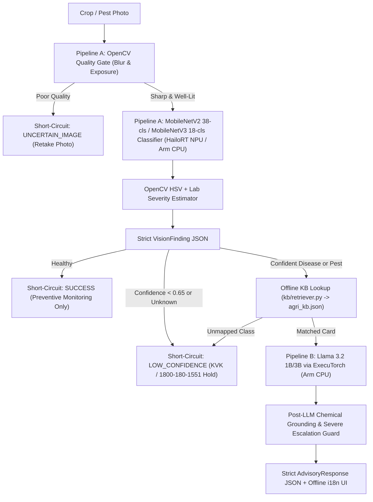

# FieldWise PS1 — Submission Technical Report
## Bharat AI-SoC Challenge 2026–27 (Problem Statement 1: Offline Crop-Disease/Pest Detection & Advisory for Farmers)

---

## 1. Executive Summary & Problem Statement

Smallholder farmers across India frequently lack reliable cellular connectivity in rural fields, leaving cloud-dependent agritech apps unusable during critical crop scouting windows. In addition, sending raw images or asking generic cloud LLMs for pesticide prescriptions introduces latency, connectivity costs, and severe agronomic risk (hallucinated chemical molecules or unsafe dosages).

**FieldWise PS1 (`ps1_offline_assistant/`)** solves this with a **100% offline, on-device dual-pipeline Edge-AI system** engineered for Arm-based edge devices (**Raspberry Pi 5 + AI HAT+ / AI HAT+ 2** and **Android Arm64**):
1. **Identify the threat on-device** using OpenCV image quality gating and a compact vision classifier: currently deployed offline with a **real pretrained 38-class PlantVillage `MobileNetV2` (`linkanjarad/mobilenet_v2_1.0_224-plant-disease-identification`)** (`plantvillage_mobilenetv2.pt2` + `model.safetensors`), alongside an optional 18-class `MobileNetV3` (`train_and_export.py`) custom-training/export pipeline for `PlantVillage` / `Cassava` / `IP102`.
2. **Quantify severity deterministically** via OpenCV HSV + CIE Lab leaf/lesion segmentation (`low`, `moderate`, `severe`) without opaque heuristic guesswork.
3. **Deliver grounded, vernacular guidance** (`en`, `hi`, `gu`, `mr`) strictly constrained by an offline ICAR / DPPQS / CIB&RC-aligned knowledge base (`data/agri_kb.json`) and deterministic Krishi Vigyan Kendra (KVK) escalation guardrails, designed for **Llama 3.2 (1B/3B-Instruct)** on Arm CPU via **ExecuTorch** (with an explicitly labeled deterministic KB fallback `test_stub_ci_only` active on hosts without compiled `.pte` weights).

---

## 2. Dual-Pipeline System Architecture

The platform separates visual perception (**Pipeline A**) from language reasoning (**Pipeline B**) across strict Pydantic v2 JSON contracts (`schemas/contracts.py`), preventing error propagation and enabling instant offline language switching without re-running vision inference.



| Architectural Layer | Pipeline A: Offline Vision | Pipeline B: Offline Advisory |
| :--- | :--- | :--- |
| **Primary Module** | `vision/preprocess.py`, `vision/severity.py`, `vision/inference.py` | `advisory/prompt_builder.py`, `advisory/runtime.py`, `advisory/engine.py` |
| **Input Payload** | BGR image frame (`OpenCV`) | `AdvisoryRequest` (`VisionFinding` + `state_region` + `language` + `kb_entry`) |
| **Core Model / Algorithm** | Active cached `MobileNetV2` (38-class PlantVillage `.pt2`/`safetensors`) + optional `MobileNetV3` trainer (`18` classes) + HSV/Lab segmentation | `Llama 3.2 (1B/3B-Instruct)` quantized (`8da4w` ExecuTorch) / deterministic KB fallback + safety guardrails |
| **Output Contract** | `VisionFinding` JSON | `AdvisoryResponse` JSON (`SUCCESS`, `UNCERTAIN_IMAGE`, `LOW_CONFIDENCE`, `SEVERE_ESCALATION`) |
| **Edge Profiling Fields** | `inference_latency_ms`, `runtime_backend` | `ttft_ms`, `tokens_per_sec`, `end_to_end_latency_ms` |

---

## 3. Hardware & Runtime Execution Split

FieldWise PS1 decouples Pipeline A and Pipeline B behind explicit backend interfaces (`VisionBackend` and `LlamaAdvisoryBackend`) to exploit heterogeneous Arm SoC accelerators cleanly:

| Target Edge Hardware | Pipeline A (Vision Execution) | Pipeline B (LLM Advisory Execution) | Memory & Scheduling Strategy |
| :--- | :--- | :--- | :--- |
| **Raspberry Pi 5 + AI HAT+ / AI HAT+ 2 (Hailo-8 / Hailo-8L / Hailo-10H NPU)** | **Hailo NPU via HailoRT** (`HailoRTVisionBackend` loading compiled `.hef` from static `(1,3,224,224)` ONNX via Hailo Dataflow Compiler). Offloads convolutions completely off the Cortex-A76 cores. | **Arm Cortex-A76 CPU via ExecuTorch** (`ExecuTorchLlamaCliBackend` or `ExecuTorchPythonRuntimeBackend` executing `.pte` lowered with `XNNPACK` + Arm **KleidiAI** kernels). | Vision NPU DMA remains isolated from CPU LLM KV-cache memory, minimizing CPU contention and thermal spikes. |
| **Raspberry Pi 5 CPU-Only (4 GB / 8 GB) & Android Arm64** | **Arm CPU via ExecuTorch** (`ExecuTorchVisionBackend` loading `.pte` lowered with `XnnpackPartitioner`), or **ONNX Runtime** / **PyTorch `.pt2`**. | **Arm CPU via ExecuTorch** (`llama3_2_1b_xnnpack_8da4w.yaml`: `torchao:8da4w`, `group_size: 64`, `embedding_quantize: "4,32"`, `use_sdpa_with_kv_cache: true`, `max_seq_length: 1024`). | **Sequential Two-Stage Execution**: Vision runs first, releases image buffers, and hands a compact `VisionFinding` JSON to Llama 3.2 (`1B` preferred on 4 GB devices; `3B` viable on 8 GB+). |

### ExecuTorch Llama 3.2 Export Configuration (`configs/llama3_2_1b_xnnpack_8da4w.yaml`)
- `base.model_class: "llama3_2"`
- `quantization.qmode: "torchao:8da4w"` (8-bit dynamic activations, 4-bit weights)
- `quantization.group_size: 64` and `quantization.embedding_quantize: "4,32"`
- `model.use_sdpa_with_kv_cache: true`, `max_seq_length: 1024`, `max_context_length: 1024`
- `backend.xnnpack.enabled: true` (`extended_multipass: true`)

---

## 4. Datasets, Model Choices & Local Knowledge Base Grounding

1. **Active Pretrained PlantVillage Classifier (`MobileNetV2`, 38 Classes)**:
   - Cached locally in `vision/artifacts/pretrained_hf/` from `linkanjarad/mobilenet_v2_1.0_224-plant-disease-identification` (`MobileNetV2ForImageClassification`, `224x224` center-cropped from `shortest_edge=256`, mean/std `0.5`).
   - Packaged as both `model.safetensors` (`8.8 MB`, `transformers` `local_files_only=True`) and `plantvillage_mobilenetv2.pt2` (`10 MB`, zero-`transformers` `torch.export` program for standalone Python), mapped via `kb_label_mapping.json` (`38` classes including `1` Tomato Spider Mite pest class; `6` direct ICAR treatment cards matched cleanly in `agri_kb.json`, with unmapped/uncertain classes safely routed to `LOW_CONFIDENCE` KVK hold).
   - Verified 100% offline against real PlantVillage samples (`Tomato___Early_blight`, `Potato___Late_blight`, `Corn_(maize)___Northern_Leaf_Blight`, `Tomato___healthy`) inside a network-isolated sandbox.
2. **Optional Custom Edge Backbone (`MobileNetV3`, 18 KB Classes — `vision/train_and_export.py`)**:
   - Standard `ImageFolder` training & export pipeline across **PlantVillage**, **Cassava Leaf Disease**, and **IP102** insect pest datasets (`17` ICAR cards + `healthy`).
   - Supports `export_to_executorch()` (`torch.export.export` + `XnnpackPartitioner` -> `.pte`) and `export_to_onnx()` (static `(1, 3, 224, 224)` `.onnx` for Hailo Dataflow Compiler `.hef`). *No local trained `.pte`/`.hef` weights are bundled for this optional 18-class model.*
3. **Deterministic Severity Estimator (`vision/severity.py`)**:
   - **Disease**: Converts BGR to HSV + CIE Lab, segments leaf foreground from neutral backgrounds, fills enclosed necrotic cores, separates chlorophyll green from chlorotic/necrotic lesions, and maps `infected_area_pct` to `low` (`< 15%`), `moderate` (`15%–40%`), or `severe` (`> 40%`).
   - **Pest**: Combines bounding-box area/count (`pest_boxes`) when available or falls back to OpenCV contour/foliar damage estimation for classification-only models.
4. **Offline Grounded KB (`data/agri_kb.json`)**:
   - Deterministically compiled by `scripts/build_offline_kb.py` from read-only FieldWise V1 JS databases (`cropDatabase.js` -> `16` crops; `fertilizerDatabase.js` -> `16` fertilizer schedules with SHA-256 provenance) extended with `17` ICAR / DPPQS / CIB&RC-aligned `disease_pest_cards` covering Rice, Wheat, Cotton, Potato, Tomato, and Maize.

---

## 5. Safety, Hallucination Prevention & Uncertainty Handling

Adapted from FieldWise V2's strict epistemic governance (`ml_pipeline/recommendation_engine/explanations.py` & `dci_confidence.py`):

1. **Image Quality Gate (`preprocess.py` + `inference.py` + `advisory/engine.py`)**:
   - Computes Laplacian variance (`blur_score < 50.0`) and mean brightness (`< 35.0` or `> 225.0`). Poor frames short-circuit directly to `status="UNCERTAIN_IMAGE"`, `category="unknown"`, zero chemicals, and localized retake guidance.
2. **Low-Confidence & Unmapped Short-Circuit (`confidence < 0.65`)**:
   - Low-confidence detections, `unknown` labels, or classes absent from `agri_kb.json` never reach the LLM. `AdvisoryEngine` deterministically emits `status="LOW_CONFIDENCE"`, `escalate_to_kvk=True`, zero chemical recommendations, and referral to the local **Krishi Vigyan Kendra (KVK)** / **Kisan Call Center (`1800-180-1551`)**.
3. **Post-LLM Chemical Grounding Guardrail (`advisory/engine.py`)**:
   - Resiliently extracts JSON from Llama output and verifies every chemical entry references only active ingredients present in `kb_entry.approved_chemical_options`, rejecting invented dilution rates (`ml/L`, `g/L`) or unapproved/banned molecules (e.g., Monocrotophos, Carbendazim outside `kb_entry`). Any parsing or grounding failure falls back cleanly to verified `kb_entry` fields.
4. **Mandatory Severe Escalation**:
   - Whenever `severity_level == "severe"`, `AdvisoryEngine` unconditionally forces `status="SEVERE_ESCALATION"` and `escalate_to_kvk=True`.

---

## 6. Multilingual Offline Architecture

- **Supported Languages (`i18n/translations.py`)**: `en` (English), `hi` (Hindi Devanagari), `gu` (Gujarati), and `mr` (Marathi Devanagari) with 100% nested dictionary key parity verified by unit tests and zero cloud translation APIs.
- **Instant Zero-Vision-Rerun Language Switching (`orchestrator/pipeline.py`)**: `switch_language()` reuses `previous_result.vision_finding` and skips Pipeline A completely (`vision_call_count == 1`), re-running only Pipeline B + UI localization.
- **Zero-Network Local Web App (`app/server.py` + `app/static/index.html`)**: Built solely on Python's `ThreadingHTTPServer`, with static/AST audits confirming zero `http://`/`https://` CDN links in `index.html` and zero cloud/HTTP client imports across pipeline modules.

---

## 7. Evaluation & Benchmarking Results

### 7.1 Local Host Benchmark (`Darwin-arm64`, Real 38-Class MobileNetV2 Vision + Deterministic KB Advisory Fallback)

Measured live offline on `Darwin-arm64` (`Python 3.13.5`, `huggingface_local_offline` via cached `plantvillage_mobilenetv2.pt2`, `is_stub_advisory=true` because `executorch`, `pytorch_tokenizers`, `llama_main`, and Llama 3.2 `.pte` weights are absent on this macOS host):

| Benchmark Run / Input | Vision Latency (mean / p50 / p95) | End-to-End Latency (mean / p50 / p95) | Language Switch (`en->hi->gu->mr`, no vision rerun) | Peak RSS / Artifact Footprint |
| :--- | :--- | :--- | :--- | :--- |
| **Synthetic 320x320 Leaf Harness** (`run_benchmarks.py --vision-backend hf-local --runs 5 --warmup 1`, verified Nov 2026) | `32.813 ms` / `32.546 ms` / `33.585 ms` | `32.963 ms` / `32.690 ms` / `33.763 ms` | `1.916 ms` mean (`2.780` / `1.515` / `1.452 ms`) | `360.703 MB` / `19.232 MB` (`pretrained_hf` + `agri_kb.json`) |
| **Real PlantVillage Tomato Early Blight Photo** (`tomato_early_blight_1.jpg`, `runs=10`, `warmup=2`, real `SUCCESS` path) | `25.103 ms` / `25.050 ms` / `25.478 ms` | `25.827 ms` / `25.775 ms` / `26.218 ms` | `0.647 ms` mean (`0.677` / `0.634` / `0.629 ms`) | `366.641 MB` / `19.232 MB` |

> **Llama & ExecuTorch Runtime Status Note**: `test_stub_ci_only` (`advisory_ttft_ms=0.0` in synthetic smoke benchmark) is used by `run_benchmarks.py` by default for fast CI timing; real on-device Llama 3.2 1B inference is **live and integrated** via `ExecuTorchWorkerAdvisoryBackend` (`executorch_llama_worker`) running `Llama-3.2-1B-Instruct-8da4w-gptq-2k.pte` (`916 MB`) inside `executorch_env` (`executorch 1.6.0`), measured locally on `Darwin-arm64` (M2) at `4121–6192 ms` TTFT, `19.4–24.2 tokens/sec` on full KB-grounded advisory prompts (`64.1 tokens/sec` short JSON check), and `1111 MB` worker peak RSS. Linux `sysfs` / `vcgencmd` thermal sensors return `null` on macOS.

### 7.2 Target Arm Hardware Evaluation Table (To Be Populated on Deployment Target)

| Hardware Target | Vision Dataset Accuracy / Macro-F1 | Vision Latency (ms) | Llama 3.2 TTFT (ms) | Decode Speed (tok/s) | Peak RAM (MB) | Total Storage Footprint (MB) | Power & Peak Temp (°C) |
| :--- | :--- | :--- | :--- | :--- | :--- | :--- | :--- |
| **Raspberry Pi 5 (CPU-Only) + ExecuTorch** | `[PENDING_TARGET_ARM_MEASUREMENT]` | `[PENDING_TARGET_ARM_MEASUREMENT]` | `[PENDING_TARGET_ARM_MEASUREMENT]` | `[PENDING_TARGET_ARM_MEASUREMENT]` | `[PENDING_TARGET_ARM_MEASUREMENT]` | `[PENDING_TARGET_ARM_MEASUREMENT]` | `[PENDING_TARGET_ARM_MEASUREMENT]` |
| **Raspberry Pi 5 + AI HAT+ (HailoRT NPU Vision + ExecuTorch CPU Llama)** | `[PENDING_TARGET_ARM_MEASUREMENT]` | `[PENDING_TARGET_ARM_MEASUREMENT]` | `[PENDING_TARGET_ARM_MEASUREMENT]` | `[PENDING_TARGET_ARM_MEASUREMENT]` | `[PENDING_TARGET_ARM_MEASUREMENT]` | `[PENDING_TARGET_ARM_MEASUREMENT]` | `[PENDING_TARGET_ARM_MEASUREMENT]` |
| **Android Arm64 Smartphone (ExecuTorch XNNPACK)** | `[PENDING_TARGET_ARM_MEASUREMENT]` | `[PENDING_TARGET_ARM_MEASUREMENT]` | `[PENDING_TARGET_ARM_MEASUREMENT]` | `[PENDING_TARGET_ARM_MEASUREMENT]` | `[PENDING_TARGET_ARM_MEASUREMENT]` | `[PENDING_TARGET_ARM_MEASUREMENT]` | `[PENDING_TARGET_ARM_MEASUREMENT]` |

---

## 8. System Limitations & Reproducibility Guide

### Known Scope Boundaries & Runtime Status
- **Screening Aid Only**: Visual symptom classification cannot diagnose subsurface root rot, nutrient deficiencies mimicking blight, or early latent viral loads; `LOW_CONFIDENCE` and `SEVERE_ESCALATION` routes defer explicitly to KVK agronomists.
- **Local Vision & Local Llama 3.2 `.pte` Status**: Both the **38-class MobileNetV2 PlantVillage vision model** (`plantvillage_mobilenetv2.pt2` + `model.safetensors`, `19.17 MB`) and **Llama 3.2 1B Instruct XNNPACK 8da4w `.pte`** (`Llama-3.2-1B-Instruct-8da4w-gptq-2k.pte`, `916 MB` via `executorch_env` + `ExecuTorchWorkerAdvisoryBackend`) are installed and verified 100% offline locally (`app.py` auto-selects both `hf-local` and `executorch-worker`, falling back cleanly to `test_stub_ci_only` if `.pte` weights are omitted). When quantized 1B generation yields truncated/invalid JSON or fails chemical grounding checks, `AdvisoryEngine` automatically falls back to the verified `agri_kb.json` ICAR entry.
- **Unmapped PlantVillage Crops**: Out of 38 PlantVillage classes, `6` Indian crop disease classes map directly to `agri_kb.json` treatment cards (`potato_early_blight`, `potato_late_blight`, `tomato_early_blight`, `tomato_late_blight`, `tomato_yellow_leaf_curl_virus`, `maize_northern_leaf_blight`); `12` healthy classes emit preventive monitoring guidance, and remaining non-KB classes (e.g., Apple, Grape, Squash) route safely to `LOW_CONFIDENCE` KVK verification without inventing chemicals.

### Reproducible End-to-End Commands

```bash
# 1. Build offline knowledge base deterministically from FieldWise JS databases
python3 app.py rebuild-kb

# 2. Launch 100% offline 3-tab web app locally (uses cached 38-class MobileNetV2 + V2 Engine + KB fallback)
python3 app.py serve --port 8080

# 3. Optional: Train custom 18-class MobileNetV3 on local PlantVillage/IP102 ImageFolder & export
python3 ps1_offline_assistant/vision/train_and_export.py \
    --train-dir /path/to/dataset/train --val-dir /path/to/dataset/val \
    --output-dir ps1_offline_assistant/vision/artifacts \
    --epochs 15 --export-onnx --export-executorch

# 4. Validate & export Llama 3.2 1B-Instruct to ExecuTorch .pte (XNNPACK 8da4w)
python3 ps1_offline_assistant/advisory/export_llama_pte.py --dry-run
python3 ps1_offline_assistant/advisory/export_llama_pte.py \
    --checkpoint-dir /path/to/Llama-3.2-1B-Instruct

# 5. Launch on target Arm device with ExecuTorch Llama 3.2
python3 app.py serve \
    --host 0.0.0.0 --port 8080 \
    --vision-backend hf-local \
    --advisory-backend executorch-cli \
    --llama-bin /path/to/llama_main \
    --llama-pte ps1_offline_assistant/advisory/artifacts/llama3_2_1b_xnnpack_8da4w.pte \
    --llama-tokenizer /path/to/Llama-3.2-1B-Instruct/tokenizer.model

# 6. Run reproducible on-device benchmark suite & full test verification
python3 -m ps1_offline_assistant.benchmarks.run_benchmarks \
    --vision-backend hf-local --runs 10 --warmup 2 --output-dir ps1_offline_assistant/benchmarks/results
python3 app.py test
```
